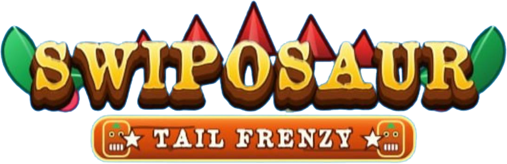
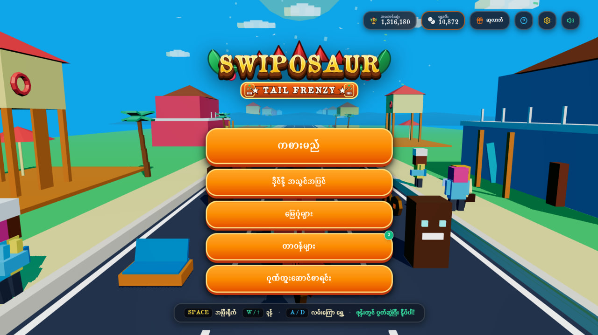
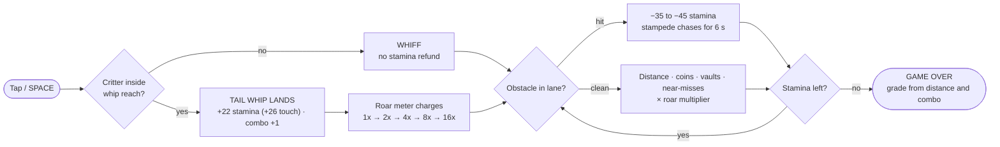
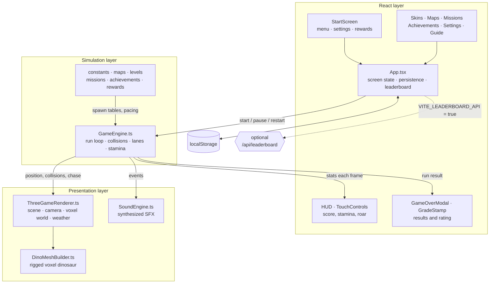

<div align="center">



<br />


### A 3D voxel dinosaur runner for the browser

Swipe between three lanes, tail-whip prehistoric critters to refill stamina,
charge the Primal Roar and outrun the stampede.

[](https://swiposaur.sithunyein.com/)

[](https://react.dev)
[](https://threejs.org)
[](https://vite.dev)
[](https://www.typescriptlang.org)
[](LICENSE)

**Digit7 Jam 2026 · HTML arcade game · built by [Sithu Nyein](https://github.com/thesithunyein)**

</div>

---

## What it is

Swiposaur is a three-lane endless runner that runs entirely in the browser: no plugins,
no sprite sheets, no audio files and no server requirement. The whole world (dinosaur,
critters, biomes, weather and sound effects) is generated in code at runtime; the only
binary files in the build are the app icons and favicons.

| | |
| --- | --- |
| **Playable build** | `v1.0.0` jam build (tag [`v1.0.0`](../../releases/tag/v1.0.0)); `main` also carries post-jam polish |
| **Live build** | <https://swiposaur.sithunyein.com/> |
| **Engine** | React 19 + Three.js, custom voxel meshes, synthesized Web Audio |
| **Entry point** | `index.html` → `src/main.tsx` |
| **Footprint** | ~1.4 MB on disk · ~306 KB gzipped (286 KB JS, 14 KB CSS) · no sprite, texture or audio files |

---

## Screenshots



*The title screen: three lanes, sidewalk critters, and the run waiting behind the PLAY button.*

---

## How it works

### Boot, then a fair first run

Launch passes through a short loading gate before the title menu: the logo, one progress
bar and one rotating tip over a daylight sky with drifting clouds and pollen. The bar is
gated by three real stages (typeface, arena, progress), so it parks at 96% until the work
actually reports in rather than faking a finish. The first load in a browser session holds
for 8 seconds — about 8.8 s including the hold and fade — so the wordmark is fully painted
before the menu; reloads in the same session take about 2.8 s, because the player has already
seen the brand moment. An ease-out curve, not a linear tick, drives the fill; a guard
releases the screen if a stage stalls, and `prefers-reduced-motion` drops the animation.

The run then opens gently: a 6-second clear runway, a first obstacle that can never be a
blind death, and three hits' worth of stamina before the stampede can end it.

### The loop



1. **Opening cinematic.** A rival blocks the road; the first tap lands a cinematic
   mega tail-whip and puts the camera behind the dino.
2. **Safe start (6 s).** The road is clear, the mob is off-camera and a mistake cannot
   end the run: the first obstacle is never a blind death.
3. **Three-hit stamina.** A stumble costs 35–45 stamina and each hit spawns the chasing
   stampede for 6 seconds unless you run clean. Running also burns stamina once the
   opening is over, and the drain climbs with the clock, so no run is infinite.
4. **Whip to survive.** A landed whip refunds +22 stamina (+26 on touch), has an
   18-frame cooldown and charges the roar meter — enough to keep the loop alive, never
   enough to erase the fatigue clock on its own.
5. **Roar multiplier.** The meter steps `1x → 2x → 4x → 8x → 16x`; every point of score
   rides on it, so chaining whips is worth more than surviving passively.

### Scoring and grades

Score mixes distance, coins, whips, vaults, near-misses and escaped chasers, all scaled by
the current roar tier, so a clean 16× chain can out-score a much longer run. The grade is
deliberately separate: it is earned on distance **and** whip chaining in the same run, so
points cannot buy a better letter.

| Grade | Title | Threshold (in one run) |
| :---: | --- | --- |
| **S+** | Apex Primal Legend | 2,000 m and a 15× roar |
| **S** | Master Dino Drifter | 1,400 m and a 10× roar |
| **A** | Speedway Champion | 800 m |
| **B** | Rising Roarer | 350 m |
| **C** | Stampede Rookie | under 350 m |

### Systems map



A single `requestAnimationFrame` loop owns the simulation: `GameEngine` advances the
world with a variable delta (capped at 32 ms), resolves lane changes, jumps and whip
hitboxes, then hands camera and entity transforms to `ThreeGameRenderer`, which draws
them with instanced voxel meshes on a single scene graph. React never re-renders per
frame; it only receives throttled stat snapshots, so the DOM stays cheap while the
canvas runs at full speed.

---

## Controls

| Action | Desktop | Mobile |
| --- | --- | --- |
| Change lane | `A` / `D`, `←` / `→` | LEFT / RIGHT buttons, swipe left / right, or tap the left / right third |
| Jump | `W`, `↑`, or `Space` when not near a critter | JUMP button or swipe up |
| Tail-whip | `Space`, `F`, `Enter`, or the whip button | 96 px WHIP button, swipe down, or tap the middle 40% |
| Pause | `P` / `Esc` | Pause button |

On touch the engine also auto-whips a glowing critter **only while the dino is airborne**,
so the one-thumb jump-and-whip clash never costs a target. Ground whips stay manual, which
keeps stamina meaningful — a run can still end.

---

## Quick start

```bash
npm install
npm run dev        # http://localhost:5173
```

Production build (this is the folder to zip for the jam submission):

```bash
npm run build      # outputs ./dist
npm run preview    # serve ./dist locally
```

Type check and tests:

```bash
npm run typecheck
npm test
```

The suite covers the run rules, obstacle spacing, mission rotation and boosts, leaderboard
validation, storage and API behaviour, and the copy the UI renders. It runs headless — no
browser, no network and no saved state required.

The optional Express/leaderboard server is not needed to play. To run the full-stack dev
server (API + Vite middleware) instead:

```bash
npm run dev:api    # http://localhost:3000
```

---

## Configuration

The game is playable with **no backend**. The global board works when the deployment
provides a durable Redis REST store:

| Variable | Default | Purpose |
| --- | --- | --- |
| `VITE_LEADERBOARD_API` | on | Set `false` to force the local-only Hall of Fame |
| `LEADERBOARD_KV_REST_URL` | unset | Redis REST endpoint for durable online scores (Vercel KV / Upstash) |
| `LEADERBOARD_KV_REST_TOKEN` | unset | Bearer token for the same store |
| `VITE_ANALYTICS_URL` | unset (off) | POST endpoint for optional gameplay telemetry (off by default) |

`KV_REST_API_URL` / `KV_REST_API_TOKEN` and `UPSTASH_REDIS_REST_URL` /
`UPSTASH_REDIS_REST_TOKEN` are also accepted. On a deployment without those credentials
the endpoint answers `503` with `storage: "unavailable"`, and the client quietly keeps
the on-device **Hall of Fame** instead of showing a fake global board. On a purely static
host the probe fails the same way. With `VITE_LEADERBOARD_API=false` the app makes **no
network requests except Google Fonts**.

Each browser gets one stable player id and a generated name (for example
`NEON_RAPTOR42`), so a new player appears on the board without filling anything in. The
name can be changed in **Settings → Leaderboard Name**, which renames your existing row
immediately. The global board keeps **one row per player**: a better run replaces your
row, a worse run changes nothing.

Online submissions are validated server-side: player and run ids, whole scores from 1 to
5,000,000, combos from 0 to 250, shipped skin ids, names sanitised to 16 characters, and
at most 6 submissions per minute per client. The same run id may be retried, but only
ever creates one record.

---

## Features

- Custom Three.js renderer: voxel dinosaur built from primitives, 9 skins, 6 biomes,
  dynamic shadows, weather and camera shake.
- Procedural Web Audio SFX — whips, blasts, coin chimes — with no audio files and no sample
  licensing. The arcade sequencer is not started during a run, so the effects carry the audio.
- A staged boot gate before the title menu: logo, one bar, one tip, drifting clouds and
  pollen, eased over 8 seconds on the first load and 2 seconds on reloads.
- Persistence: high score, coins, skins, levels, achievements, daily rewards, missions and
  banked stamina are stored locally (`localStorage`).
- Five daily missions, drawn from a rotating twelve-mission pool and reset at 00:00
  Myanmar time (UTC+06:30). Each one covers a different skill, pays 80-150 coins and
  banks **+20 stamina on the next run** when claimed.
- Login eggs grow on consecutive days and step back a single stage after a missed day
  instead of resetting the streak.
- The results card names the one thing that was close — the next grade in metres, the next
  Roar tier, or the daily mission — instead of a generic "good job", and offers a **+20
  stamina retry** once every 3.5 hours.
- Mobile-first layout: safe-area insets, 360×640 minimum viewport, four thumb-sized
  controls (96 px whip) and a full-screen swipe layer.
- Touch runs get a 12% wider three-lane street, a camera that sits higher and further back
  to show more of the road ahead, +26 stamina per whip (desktop +22), and a gentler
  obstacle curve — 55/80/100% of rows by distance band instead of 70/90/100%.
- Airborne-only auto-whip on touch: the engine swings at a glowing critter while the dino
  is in the air (where one thumb cannot jump and whip), never on the ground, so the run
  still has a failure state.
- Jumping clears low street clutter (crates, barrels, barriers, spikes). Carts, shifting
  blocks, gates and other solid props must be dodged instead.
- Ramps are optional boost pads in the open lane and only launch a grounded runner.
- The open lane never moves more than one lane between segments, so the corridor is
  always reachable at the current speed.
- Obstacle rows arrive about one second apart at every speed: the world-unit gap
  widens with the runner (300 units at the start, ~520-620 at the speed cap), so
  distance adds density without the warning window collapsing.
- Global leaderboard of every player's highest score, one row per player. A new device
  gets a generated name such as `IRON_TALON77`; players can rename themselves in
  Settings at any time.
- Local Hall of Fame fallback that works with no server, labelled "Saved on this device"
  with a local rank. It stores one record only: this device's highest score.

---

## Supported environments

- Built for Chrome, Edge, Firefox and Safari (current stable), desktop and mobile.
- Verified in Chrome at 360×640, 390×844 and 1280×720. Edge uses the same engine.
- Firefox and Safari are supported targets but have not been verified on physical devices.
- Targets Android 10+, iOS 16+, Windows 10/11 and recent macOS. Requires WebGL.
- Recommended: portrait on phones, any orientation on desktop.

---

## Known limitations

- **No service worker / offline install.** The app ships a web manifest so "Add to Home
  Screen" creates a shortcut, but there is no offline cache and no install prompt.
- **The global board needs durable storage** (see Configuration). Without Redis REST
  credentials the game stays on the local Hall of Fame rather than inventing a board.
  Online scores are self-reported and not cheat-proof — the server validates shape and
  rate limits, but does not verify a signed run or replay.
- Clearing browser storage gives that device a new player id, so it appears as a new
  player on the global board.
- External font requests to `fonts.googleapis.com`; if the network blocks them the game
  falls back to system sans-serif.
- Very old low-end Android devices with weak GPUs may drop below 30 FPS at 2× pixel ratio.

---

## Project structure

```
index.html                      page shell, fonts, meta tags
src/main.tsx                    React entry
src/App.tsx                     screen state, persistence, HUD wiring
src/components/                 Start screen, HUD, rating stamp, modals
src/components/BootScreen.tsx   loading gate shown once before the title menu
src/game/useBootSequence.ts     staged boot progress, 8 s first load / 2 s reloads
src/game/GameEngine.ts          run loop, collisions, whip, stamina, chase, scoring
src/game/ThreeGameRenderer.ts   scene, camera, track and world rendering
src/game/DinoMeshBuilder.ts     voxel dinosaur construction
src/game/SoundEngine.ts         Web Audio synthesis
src/game/grades.ts              grade tiers shared by the results card, missions and coach
src/game/dailyMissions.ts       deterministic five-a-day missions on Myanmar time
src/game/runBoosts.ts           banked stamina and the retry-boost cooldown
src/game/coach.ts               the single actionable line on the results card
src/game/obstacleDensity.ts     desktop vs touch obstacle curve
src/game/leaderboard.ts         local Hall of Fame storage and online client
src/game/leaderboardCore.ts     shared validation and ranking rules
src/game/*.ts                   constants, maps, levels, missions, rewards, achievements
server/leaderboardStore.ts      durable file / Redis REST stores, idempotent by runId
api/leaderboard.ts              optional serverless endpoint (disabled without a store)
server.ts                       optional Express dev server with the same endpoints
tests/                          Vitest coverage for rules, storage, API and UI copy
docs/brand/                     README logo and seal artwork
docs/screenshots/               screenshots used by this README
```

---

## Asset credits

| Asset | Source | License |
| --- | --- | --- |
| All 3D models, textures and UI art | Generated in code with Three.js primitives and inline SVG | Original work, Apache-2.0 |
| Logo and icons | Inline SVG in `src/components/GameLogo.tsx`, exported to `docs/brand/` | Original work, Apache-2.0 |
| Music and sound effects | Synthesized at runtime with the Web Audio API | Original work, Apache-2.0 |
| Fonts: Fredoka, Lilita One, Titan One, Sniglet, Press Start 2P | Google Fonts | SIL Open Font License 1.1 |
| React, React DOM | react.dev | MIT |
| Three.js | threejs.org | MIT |
| Vite, Tailwind CSS | vite.dev, tailwindcss.com | MIT |
| lucide-react | lucide.dev | ISC |
| TypeScript | typescriptlang.org | Apache-2.0 |
| Express (optional dev server) | expressjs.com | MIT |

No third-party art, audio, sprites or templates are included. No paid assets.

## AI use

AI tools were used during development and are disclosed here as required:

- **Google AI Studio (Gemini):** initial project scaffolding, component drafts and UI copy.
- **An AI coding assistant:** refactors, gameplay tuning, documentation and code review.

Human review: every file was read, tested and modified by the developer; behaviour was
verified in Chrome at 360×640, 390×844 and 1280×720 (Firefox and Safari were not run);
no generated art or audio is used
(all visuals are code-drawn and all sound is synthesized). The developer is responsible
for the submitted code and can explain any part of it.

## License

Copyright 2026 Sithu Nyein.

The game — source code, code-generated art and synthesized audio — is licensed under
[Apache-2.0](LICENSE). The full license text in `LICENSE` is the canonical statement, and
`package.json` declares the same SPDX identifier (`Apache-2.0`).

Bundled dependencies keep their own licenses: React, React DOM, Three.js, Vite,
Tailwind CSS and Express are MIT, lucide-react is ISC, TypeScript is Apache-2.0, and the
Google Fonts families are SIL OFL 1.1.
