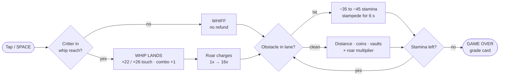
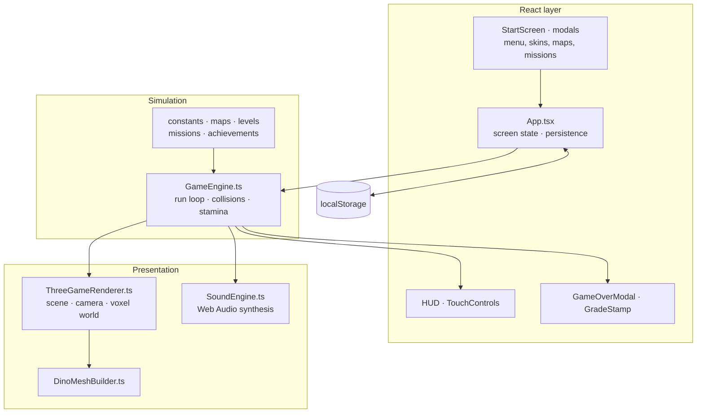

 

### Digit7 Jam 2026 · HTML arcade game · v1.1.0

**Team:** Solo Canvas — Sithu Nyein (solo)

## 1. Game title

**Swiposaur: Tail Frenzy**

## 2. Team name

**Solo Canvas** (solo entry; team leader Sithu Nyein)

## 3. Main contact person

Sithu Nyein, sithunyein.mailto@gmail.com, Telegram: @thesithunyein

## 4. Short game description

Swiposaur is a 3D voxel arcade runner. You play a party-sunglasses dinosaur sprinting
through prehistoric streets: change lanes, vault barriers and **tail-whip** pedestrians to
refill stamina and charge the Primal Roar. One mistake brings the stampede onto your heels;
three mistakes end the run. Skins, biomes, daily missions and a local Hall of Fame keep runs
coming.

## 5. How to open and play

1. Open the current playable build at <https://swiposaur.sithunyein.com/> (or build the `main` source linked in §16).
2. No install, login or download is required. The game starts on the title screen.
3. Press **PLAY**. The opening cinematic asks for one tail-whip (tap / `Space`).
4. After the intro you get a **6-second safe start** before the stampede begins.
5. Survive as long as possible, whip critters to refill stamina, and chase a higher grade.

Local build: `npm install && npm run build`, then serve `dist/` (or `npm run preview`).

## 6. Supported browsers

Chrome, Edge, Firefox and Safari, current stable. Verified: Chrome (desktop and mobile, at
360×640, 390×844 and 1280×720), Firefox, Edge, and Safari on macOS and iPhone. All four
engines run the same build. WebGL required.

## 7. Supported devices

Android 10+, iOS 16+, Windows 10/11, recent macOS. Also works in mobile WebViews.
Best on a phone in portrait (360×640 and up) or any desktop window (1280×720 and up).

## 8. Controls and gameplay

- **Language:** Burmese by default; English is one tap away in Settings and the choice is
  remembered on the device. Every map, skin and mission name is translated.
- **Lane change:** `A`/`D` or `←`/`→`; on touch the LEFT/RIGHT buttons, a swipe
  left/right, or a tap on the left/right third.
- **Jump:** `W`, `↑`, `Space` when not beside a critter; on touch the JUMP button or a
  swipe up.
- **Tail-whip:** `Space`, `F`, `Enter`, or the whip button; on touch the 96 px WHIP
  button, a swipe down, or a tap in the centre.
- **Pause:** `P` / `Esc` or the pause button.

On touch the engine auto-whips a glowing critter only while the dino is airborne, covering
the moment one thumb has to jump and whip at once. Ground whips stay manual, so stamina
can still run out and a run can still end; touch whips refund +26 stamina instead of +22.

Scoring: distance + coins + vaults + near-misses + whip combos, multiplied by the Roar
meter (1×–16×). Stamina falls to fatigue while running and is partly refunded by a landed
whip (+22 on keyboard, +26 on touch), so every run has a ceiling.

Grades are read off the run itself, not the score: the tier comes from distance plus the
roar combo reached in the same run — **C** under 350 m · **B** 350 m · **A** 800 m ·
**S** 1,400 m with a 10× combo · **S+** 2,000 m with a 15× combo.

### How it works

## 9. Known bugs and limitations

- No offline mode: there is **no service worker**, so there is no install prompt and no
  cached play. "Add to Home Screen" only creates a shortcut.
- The Hall of Fame falls back to the device (labelled "Saved on this device" with a local
  rank) whenever `/api/leaderboard` is missing or does not report durable storage. The
  online board is on by default, needs a durable Redis REST store on the server, and is a
  community leaderboard: scores are self-reported and validated for shape, rate and
  plausibility, not cheat-proof.
- Fonts load externally: Google Fonts supplies the display families and Noto Sans Myanmar
  (CSS from `fonts.googleapis.com`, font files from `fonts.gstatic.com`); Aka 08 loads from
  jsDelivr. If blocked, the UI falls back to available system and platform Myanmar fonts.
- Very low-end GPUs may dip below 30 FPS at high device pixel ratios.

## 10. Third-party tools and libraries

React 19, React DOM, Three.js r186, Vite 8, Tailwind CSS 4, TypeScript, lucide-react,
Express (optional dev server only). No game engine, template or paid asset pack is used.

### Architecture

## 11. Asset credit summary

- Copyright: © 2026 Sithu Nyein. The game is licensed **Apache-2.0**; the full text is in
  `LICENSE`, and `package.json` declares the same identifier.
- All art, 3D models, textures, logo and icons: original, generated in code (Three.js
  primitives + inline SVG), Apache-2.0.
- All audio: original, synthesized at runtime with the Web Audio API. No audio files.
- Fonts: Fredoka, Lilita One, Titan One, Sniglet, Press Start 2P and Noto Sans Myanmar
  (Google Fonts, SIL OFL 1.1), plus Aka 08 for the Burmese UI (credited to
  [saturngod/myanmar-unicode-fonts](https://github.com/saturngod/myanmar-unicode-fonts),
  served by jsDelivr). The source repository metadata does not state Aka 08's license;
  its redistribution terms remain unverified.
- Code libraries: MIT / ISC / Apache-2.0, see `README.md` for the full table.
- No third-party art, sprites, music or purchased assets are included.

## 12. Special testing instructions

- Test both a desktop browser and a phone; touch controls are four buttons
  (LEFT, RIGHT, JUMP, 96 px WHIP) plus swipes anywhere on screen: left/right to
  change lane, up to jump, down to whip. The engine auto-whips a glowing walker
  only while the dino is airborne, which covers the jump-and-whip clash on one
  thumb; ground whips stay manual, so stamina can still run out and a run can end.
- Touch runs are tuned a little softer than keyboard runs: a 12% wider road
  (same three lanes, more room between them), a camera that sits higher and
  farther back to show more of the road ahead, +26 stamina per whip (keyboard
  +22), and fewer obstacles (55/80/100% of rows by distance band vs desktop
  70/90/100%). In both modes 70% of obstacle rows fill two lanes and 30% fill
  one, so a clear lane always exists. Compare the same distance on both if a run
  feels off.
- If a run feels too easy or too hard, note the grade and distance on the game-over card.
- Leaderboard smoke test: finish a run → the game-over card should say "LOCAL RANK" and
  "Saved locally". Only a successful, persisted online response may show "GLOBAL RANK".
- To reset progress: Settings (gear icon, top right of the menu) → Reset progress, or
  clear site data.
- Quick smoke test: PLAY → whip the intro rival → survive 6 s → whip a sidewalk critter
  (stamina +26 on a phone, +22 on keyboard) → pause → resume → finish the run and
  check the grade card.

## 13. Recommended orientation, resolution, aspect ratio

Portrait on phones (about 9:19.5, minimum 360×640). Desktop: any orientation, 1280×720 or
larger. The canvas fills the viewport and letterboxes nothing.

## 14. Network, API and third-party services

- **Required network:** none. The game is fully client-side.
- **Leaderboard probe:** on by default — the client asks `/api/leaderboard` once per
  session. Set `VITE_LEADERBOARD_API=false` to switch it off entirely. The endpoint needs
  a durable store (`LEADERBOARD_KV_REST_URL` + `LEADERBOARD_KV_REST_TOKEN`, or the Vercel
  KV / Upstash equivalents) before it reports online mode; without one it answers
  `storage: "unavailable"` and the game stays on the local Hall of Fame.
- **Telemetry:** `VITE_ANALYTICS_URL` is **unset** in the submitted build, so no gameplay
  telemetry is sent.
- **External requests in the submitted build:** the Google Fonts stylesheet and font files
  (Google Fonts uses `fonts.googleapis.com` and `fonts.gstatic.com`), and the Aka 08 Myanmar
  font file from jsDelivr. The leaderboard option is on by default and probes the same-origin
  `/api/leaderboard`; it may also POST a run or rename when a durable online board is active.
  Set `VITE_LEADERBOARD_API=false` to disable leaderboard requests. With `VITE_ANALYTICS_URL`
  unset, no gameplay telemetry is sent.
- **Storage:** `localStorage` for scores, coins, skins, settings, missions and achievements.
- No accounts, cookies, ads, trackers, crypto, downloads or device permissions.

## 15. AI tools used and purpose

- **Google AI Studio (Gemini):** initial scaffolding, component drafts, UI copy.
- **An AI coding assistant:** refactors, gameplay tuning, documentation and review.

Affected areas: most of `src/` was AI-assisted and then reviewed, tested and edited by the
developer. No AI-generated images, audio or fonts are shipped: all visuals are code-drawn
and all sound is synthesized. The developer has read and can explain every file and is
responsible for the submitted code.

## 16. Repository and build access

- Repository: https://github.com/thesithunyein/swiposaur
- Current judging version: `v1.1.0`, source on [`main`](https://github.com/thesithunyein/swiposaur/tree/main), with matching package metadata; this is the post-jam build described in this document.
- Historical jam tag: [`v1.0.0`](https://github.com/thesithunyein/swiposaur/tree/v1.0.0), an earlier six-biome snapshot without Burmese localization; it is not the build described here.
- Build this source: `npm install && npm run build` → `dist/`
- The repository is public, so reviewers can open it without an invitation. If the
  organizer requires a private repository, access will be granted to the announced
  reviewer account before the deadline.

## 17. Build version

**Current judging build, v1.1.0:** the post-jam source on [`main`](https://github.com/thesithunyein/swiposaur/tree/main), with twelve biomes and English/Burmese localization. The public playable URL was checked on 29 October 2026 and serves this post-jam feature set; its exact deployed commit is not asserted here. The original `v1.0.0` tag remains the historical six-biome jam snapshot.
